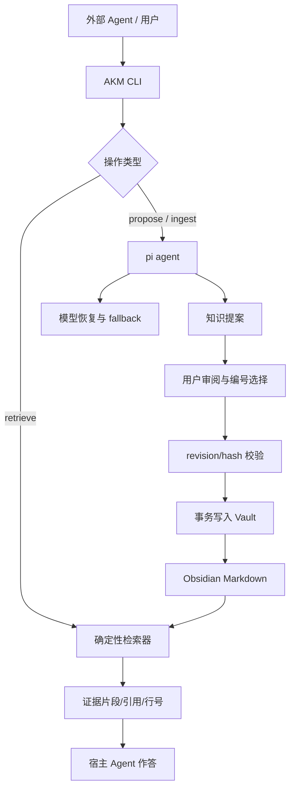

# AKM

AKM（Agentic Knowledge Management）是一个本地优先的知识管理工具：用 **Obsidian Markdown** 保存知识，用 **pi agent** 做文档提取、对话总结和基于证据的问答。

它的核心工作方式是：

```text
输入文档 / 对话 → pi 生成知识提案 → 用户审阅 [1] [2] … → 确认后写入 Obsidian Vault → 需要时显式检索证据
```

AKM 不会把模型输出直接写入知识库，也不会把 API 密钥写入 Vault。

## 特性

- 本地 Obsidian-compatible Vault，整个目录可复制、备份和迁移。
- 支持文档 ingest、对话总结两种归档入口。
- 提案只展示需要确认的字段：`domain`、`tags`、`aliases`、`related` 和正文。
- 提案使用稳定编号，支持选择、编辑、合并、撤回和幂等提交。
- 检索默认只读，返回页面哈希、来源、片段和行号；需要明确要求时才调用模型回答。
- 支持 OpenAI-compatible provider；模型、fallback 和恢复策略按 workspace 独立配置。
- 支持跨 domain 的 related，同时可以先限定检索 domain。
- 写入具有 revision、哈希校验、事务日志和恢复机制。

## 5 分钟开始使用

要求 Node.js **>= 22.19.0**。

```sh
npm ci
npm link                 # 可选：安装 akm 命令
akm init                 # 默认创建 ~/.akm/vaults/default
akm status --json
```

不安装全局命令时使用 `node bin/akm.js`。初始化时也可以导入已有 Obsidian Vault：

```sh
akm init --vault-path /absolute/path/to/obsidian-vault
```

日常命令只访问当前 active Vault，不需要反复提供路径：

```sh
akm vault list --json
akm vault use default
akm status --json
```

## 归档工作流

### 从文档归档

```sh
akm propose --file inbox/architecture.md \
  --domain "分布式系统" --json
```

命令只生成提案，不写入正式知识。宿主 Agent 应向用户展示类似内容：

```text
[1] 租约与 fencing token
领域：分布式系统
标签：#分布式系统 #一致性
别名：lease fencing
相关：[[分布式系统/租约与 fencing token]]

正文：...
```

用户确认后提交：

```sh
akm proposal inspect PROPOSAL_ID --json
akm review PROPOSAL_ID --revision REVIEWED_REVISION --input edits.json --json
akm commit PROPOSAL_ID --revision REVIEWED_REVISION --items 1,2 --json
```

支持 UTF-8 Markdown/TXT，单个输入最大约 2 MiB。长文会自动分块，并在写入前进行合并审阅。

### 从对话总结

准备一个对话文件：

```json
{
  "conversation_id": "design-review-1",
  "messages": [
    {"id": "m1", "role": "user", "content": "最终决定服务端负责最终状态。"},
    {"id": "m2", "role": "assistant", "content": "客户端只保留临时缓存。"}
  ]
}
```

生成提案：

```sh
akm propose --input conversation.json --domain "分布式系统" --json
```

模型必须为每条知识标记支持它的消息 ID。用户只确认选中的知识点，未确认的内容不会进入正式 Vault。

### 修改已有知识

修改时必须指定目标页面，AKM 会把完整旧正文提供给模型，并要求生成一项全量 update：

```sh
akm propose --file review.md \
  --domain "分布式系统" \
  --page "projects/分布式系统/租约与 fencing token.md" \
  --json
```

提交前会检查目标页面哈希。如果页面在模型处理期间被其他进程修改，提案会失败并要求重新生成，避免覆盖新内容。

## 检索与问答

### 只检索证据

```sh
akm retrieve --domain "分布式系统" \
  --query "租约过期后为什么还需要 fencing token" --json
```

返回页面标题、相对路径、domain、页面 hash、原文片段、行号、Obsidian citation 和来源引用。

### 让 pi 基于证据回答

```sh
akm retrieve --domain "分布式系统" \
  --query "租约过期后为什么还需要 fencing token" --answer
```

`--answer` 才会调用模型。回答链路会先取证，必要时通过 `akm_retrieve_evidence` 批量补充证据，再生成中文回答。证据不足时应明确说明，不会把低相关候选当成事实。普通情况下，外部 Agent 直接使用 `akm retrieve` 更省 token。

## Vault、workspace 和 domain

### Vault

Vault 是一个可整体迁移的知识库边界。默认根目录是 `~/.akm`：

```text
~/.akm/
├── config.json
├── workspaces/default/
│   ├── workspace.json
│   └── .pi/models.json
└── vaults/default/
```

单个 Vault 可以整体复制到新的 AKM 根目录。只有在权限、生命周期或同步边界不同的时候才需要拆分 Vault。

### Workspace

Workspace 保存 active Vault 和 pi 模型配置。每个 workspace 可以使用不同的 provider、模型和 fallback：

```sh
akm model configure \
  --workspace default \
  --base-url https://provider.example/v1 \
  --model DeepSeek-V3-FRIDAY \
  --fallback-models LongCat-Flash-Chat,MiniMax-M2.7 \
  --api-key-env AKM_PROVIDER_KEY
```

凭据只通过环境变量提供：

```sh
export AKM_PROVIDER_KEY='...'
```

### Domain

Domain 是 Vault 内的语义筛选和归属信息，不是第二个物理隔离层。不同 domain 的页面仍然可以通过 Obsidian link 互相引用：

```sh
akm domain list --json
akm domain show --name "分布式系统" --json
akm domain search --query "一致性" --json
```

每个知识页属于一个主 domain；`related` 可以指向同一个 Vault 内其他 domain，但必须使用系统发现的精确路径，不能由模型猜路径。

## 目录结构

```text
~/.akm/vaults/default/
├── vault.json
├── index.md
├── .obsidian/
├── inbox/                     # 待处理输入
├── projects/<domain>/         # Obsidian 页面；domain 是语义归属
├── sources/                   # 来源副本，不参与 Obsidian Graph
├── .raw/                      # 选中的原始片段
├── .akm/
│   ├── domains.json           # domain 注册表
│   ├── ledgers/               # 来源和操作记录
│   └── runs/                  # 模型调用统计
└── .vault-meta/
    ├── proposals/             # 待审阅提案
    ├── transactions/          # 事务日志和恢复备份
    └── source-cache/          # 幂等提取缓存
```

`sources/` 会保留来源，但不会作为普通知识节点加入 Graph。知识页面中的引用使用 Obsidian wiki link 和相对路径，因此复制 Vault 后仍然有效。

## 架构



代码层次：

| 模块 | 职责 |
| --- | --- |
| `src/storage.js` | Vault、workspace、页面和路径安全 |
| `src/retrieve.js` | 字段加权 BM25、中文双字片段、domain 过滤 |
| `src/evidence.js` | 证据聚合、章节目录、预算和来源多样化 |
| `src/pi.js` | pi SDK session、提取、问答和模型调用 |
| `src/pi-tools.js` | `akm_search`、`akm_read`、`akm_retrieve_evidence` |
| `src/knowledge.js` | 提案、审阅、提交和 related 维护 |
| `src/transaction.js` | 写锁、原子替换、恢复和冲突检测 |
| `src/model-recovery.js` | 重试、超时和有序 fallback |
| `skills/akm/SKILL.md` | 给 Codex、Claude Code 等宿主 Agent 的调用协议 |

## 模型与 pi SDK

AKM 使用 pi SDK 创建独立 session，并为每个 workspace 保存独立的 `models.json`。模型失败时按配置执行有限重试和有序 fallback；已经执行过的工具结果不会重复执行。模型调用和工具调用统计会写入 Vault 的 `.akm/runs/`，凭据不会写入日志。

## 检索策略

当前版本是本地、可解释的词法检索，不是向量数据库：

- 标题、alias、tag、正文分别加权。
- 中文使用单字和双字片段；英文保留技术术语和数字 token。
- 短查询保留召回率，长自然语言查询启用多词匹配门，减少常见词误召回。
- domain 是初步筛选范围；related link 不会自动扩大当前检索范围。
- 检索不会写入知识页，只创建短期锁。

真实语料验证材料位于 `artifacts/real-corpus-2026-10-16/`，包含独立 test vault、168 个页面和 127 个查询。

## 测试与 benchmark

```sh
npm test
npm run benchmark

# 构建独立真实语料 test vault
python3 scripts/build-real-corpus.py
node scripts/validate-real-corpus.js
```

回归测试覆盖新增、更新、合并、对话提取、文档 ingest、domain 过滤、跨 domain related、证据补读、pi 工具调用、provider fallback、active Vault 恢复、外部修改冲突和事务恢复。

benchmark 指标包括 Recall@3、MRR@3、nDCG@3、负样本 emptyCorrect，以及排名延迟 p50/p95。排名延迟不包含磁盘、网络或 LLM 调用。

## 当前边界

当前版本暂不包含：

- PDF/OCR 自动 ingest
- 自动捕获所有聊天记录
- 异步任务队列
- 向量检索和语义重排
- 多 Vault 的模块导出依赖打包
- 自动发布或自动提交未经审核的知识

## 项目文档

- [AKM 设计](docs/akm-design.md)
- [Domain 架构设计](docs/akm-domain-architecture-design.md)
- [模型恢复说明](docs/model-recovery.md)
- [优化进度](docs/workflow/optimization-progress.md)
- [AKM skill](skills/akm/SKILL.md)

## License

当前仓库尚未声明开源许可证，代码仅用于内部实验和评估。
