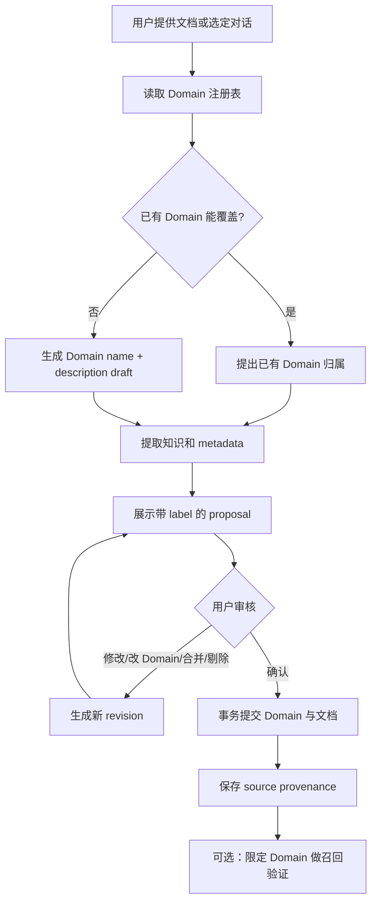

# AKM Domain 模型与归档架构技术设计

日期：2026-10-14  
状态：设计基线，待实现  
版本：0.2.0-design

## 1. 摘要

本设计将 AKM 的主题组织单位从 `project` 改为 `domain`。Domain 是带有名称和描述的语义分类，以及 agent 进行检索前置筛选时使用的范围；它不是文件系统隔离边界，也不限制知识之间建立关系。

默认 AKM 工程只有一个 Vault。Vault 才表示权限、生命周期、同步、备份和整体迁移边界。普通主题（例如“音乐理论”“交易”“分布式数据”）都作为同一 Vault 内的 Domain 保存。

文档归档采用统一的提案流程：agent 先查询 Domain 注册表和描述，再为文档提出 Domain 归属；如果没有合适的 Domain，提案同时包含待审核的 Domain 名称和描述。用户确认后，Domain 和文档在同一个事务中提交。

本设计延续当前 AKM 的 Obsidian Markdown、pi SDK、CLI/JSON contract、人工确认、原子提交和来源溯源机制；借鉴 claude-obsidian 的 inbox、资料加工和显式归档思路，但不引入其运行时依赖。

## 2. 背景与问题

当前实现存在四个结构性问题：

1. `project` 同时承担主题分类、路径分隔和 related 边界，导致语义和存储职责耦合。
2. related 被限制在同一 project；这会阻止同一知识图谱内真实存在的跨主题关系。
3. source 以 `sources/*.md` 形式写入 Obsidian 可见目录，并通过 wikilink 关联，source、hash 和 index 会污染 Graph。
4. agent 没有读取 Domain 名称和描述的独立接口，只能依靠 project 列表和路径猜测归属；当领域数量增多时，分类质量会下降。

本设计的目标是让“知识归属”“检索范围”“关系边界”“文件迁移”分别由明确的概念负责。

## 3. 目标与非目标

### 3.1 目标

- 一个默认 AKM 工程通常只使用一个 Vault。
- Domain 是可查询的语义对象，包含名称、描述和稳定 ID。
- agent 可以在归档前查询 Domain 列表、单个 Domain 详情和候选 Domain。
- 新文档的 Domain 归属必须出现在提案中；新 Domain 的名称和描述也必须先审核。
- 同一 Vault 内允许跨 Domain 的 related。
- Domain 是检索的软过滤器；不指定 Domain 时才执行全局检索。
- source、proposal、ledger 等内部数据不进入 Obsidian 知识 Graph。
- 复制一个 Vault 文件夹可以迁移全部知识；Domain 不要求物理目录隔离。
- 保留 CLI、JSON contract 和 pi custom tools 的统一业务实现。

### 3.2 非目标

- 本阶段不引入多 Vault 间的普通 Obsidian wikilink。
- 本阶段不要求一个文档拥有多个主 Domain；一个文档默认只有一个 `domain`。
- 本阶段不实现 Domain 自动合并、全量关系重写或 project 级独立导出。
- 本阶段不引入向量数据库、后台异步 worker、PDF/OCR 或自动记录全部对话。
- 不把 Domain 描述当作事实内容；它只用于分类、路由和检索解释。

## 4. 核心概念和边界

| 概念 | 业务含义 | 是否硬边界 | 主要用途 |
| --- | --- | --- | --- |
| AKM 根目录 | CLI、workspace、Vault 注册和运行状态 | 否 | 自动发现和运行配置 |
| Vault | 可独立打开、备份、迁移的知识图谱 | 是 | 权限、生命周期、整体迁移 |
| Domain | 有名称和描述的语义领域 | 否 | 归档分类和检索前置筛选 |
| Document | 正式知识页面 | 否 | Obsidian Graph 节点 |
| Tag | 跨 Domain 的多维分类 | 否 | 辅助检索和视图筛选 |
| Related | 明确存在的知识关系 | Vault 内有效 | Obsidian wikilink 和关系图 |
| Source | 原始文档或授权对话片段 | 否 | 溯源、审计和重新处理 |
| Workspace | pi provider、模型和运行时设置 | 否 | agent 运行配置 |

### 4.3 Active Vault 工作状态

AKM 为每个 workspace 维护一个 `activeVaultId`。它表示当前工作状态，也是所有普通知识操作的默认范围：

- `retrieve`、`query`、`propose`、`ingest`、`show` 和 pi knowledge tools 只访问 active Vault；
- 普通检索不自动遍历其他 Vault；
- 用户不需要重复提供 Vault 路径；
- 单 Vault 初始化后自动将该 Vault 设为 active；
- 普通知识命令不通过一次性 `--vault` 绕过 active 状态；需要检索另一个 Vault，先显式执行 `akm vault use`。

active 状态属于 workspace，而不是全局进程变量。这样不同 agent 或并行任务可以使用不同 workspace，各自拥有独立的 active Vault，不会互相覆盖。

建议接口：

```text
akm status --json
akm vault use NAME_OR_ID
akm vault list --json
```

`akm status` 展示当前 Vault 名称和稳定 ID，不展示内部绝对路径。`akm vault use` 是持续切换；`--vault` 仅保留给 Vault 管理、迁移和诊断命令，不用于普通知识检索或归档。

### 4.1 Vault 判定准则

只有当至少一个硬边界成立时，才创建新的 Vault：

- 权限、保密级别或数据控制者不同；
- 所属组织、客户或身份不同；
- 需要独立同步、备份、交付或销毁；
- 不允许同一 agent 在默认情况下检索到；
- 使用完全不同的运行时策略且不希望共享配置。

“属于另一个领域”不是创建 Vault 的理由。个人的交易、音乐理论和分布式数据默认位于同一个 Vault。

### 4.2 Domain 判定准则

Domain 是稳定、可复用的语义范围。它应有包含范围和必要的排除范围，例如：

```yaml
name: 音乐理论
description: >
  研究音高、音程、和弦、和声进行、调式与曲式；
  不包含音乐史、乐器制作和音频工程。
```

agent 应优先复用已有 Domain。只有当现有 Domain 描述无法准确覆盖新内容，或加入新内容会使边界明显过宽，才提出新 Domain。

Domain 可以跨 Domain 建立 related；Domain 本身不构成关系阻断条件。

## 5. 目标存储布局

目标布局将知识内容和 AKM 内部数据分开。物理路径是浏览和迁移实现细节，不是 Domain 的权威身份。

```text
~/.akm/
├── config.json
├── workspaces/
│   └── default/
│       ├── workspace.json          # activeVaultId、provider/model 引用
│       └── .pi/
└── vaults/
    └── vault/
        ├── vault.json
        ├── .obsidian/
        ├── inbox/
        ├── notes/                    # 正式知识页面，可被 Obsidian Graph 展示
        ├── sources/                    # 原始内容，使用 .txt/.json，不进入 Graph
        ├── .akm/
        │   ├── domains.json           # Domain 注册表
        │   ├── proposals/
        │   ├── ledgers/
        │   └── indexes/
        └── README.md                  # 可选的人类入口页
```

正式文档使用 frontmatter 表达 Domain：

```yaml
---
id: note-01H...
domain: 音乐理论
tags:
  - 和声
  - 和弦
aliases:
  - Chord Inversion
related:
  - "[[泛音列]]"
source_refs:
  - source-01H...
---
```

## 5.1 Vault 初始化与接入

初始化 AKM 时先检查 `~/.akm/vaults/`：

1. 目录不存在或目录为空时，agent/CLI 向用户提示是否创建 Vault。
2. 用户确认创建时，默认名称为 `default`；用户可以在确认时提供名称。
3. 如果用户提供一个现有 Vault 路径，AKM 不直接使用该路径作为内部运行目录，而是先校验，再复制到 `~/.akm/vaults/<名称>/`。
4. 复制后的 Vault 名称沿用源目录的最后一级目录名；如果名称不符合组件规则或目标已存在，要求用户提供新名称或选择其他目标。
5. 复制完成后生成或补齐 `vault.json`、根配置登记和必要的 `.akm/` 目录；原始目录保持不变。

用户可以用自然语言表达：

```text
初始化 AKM。当前没有 Vault，创建一个默认 Vault。
```

或：

```text
初始化 AKM，把 /Users/me/Obsidian/Music 作为现有 Vault 接入。
```

### 5.1.1 合格 Vault 的校验

外部路径必须满足以下条件：

- 是可读目录，不是文件或符号链接；
- 目录内不存在越界符号链接；
- 存在至少一个可读 Markdown 文档，或存在 `.obsidian/` 配置目录；
- 不包含正在进行的 AKM 写事务，或者事务可以被安全恢复；
- 现有内容能被安全扫描，frontmatter 损坏和不支持的文件格式只作为迁移报告，不得静默丢弃。

如果目录已经包含 `vault.json`，沿用其稳定 Vault ID 和名称；如果只是普通 Obsidian Vault，则生成 AKM manifest，但不能覆盖原有 `.obsidian` 设置和用户文档。复制过程完成前不写入 AKM 根配置，失败时删除不完整副本。

### 5.1.2 初始化后的默认选择

- 只有一个 Vault 时，所有常规命令自动使用它，不要求用户传 `--vault`。
- 多个 Vault 时，workspace 的 `activeVaultId` 决定常规命令的范围；需要切换时使用名称或稳定 ID。
- 名为 `default` 的 Vault 只是默认实例名称，不表达“个人知识”或某个主题。
- 外部 Vault 的原始目录与复制后的 AKM Vault 是两个独立副本；后续同步不在本阶段自动提供。

迁移阶段可以继续读取现有的 `projects/<name>/` 路径，但新代码不得把路径当作 Domain 的唯一来源。物理目录可作为人工浏览的镜像，metadata 才是归属真相。

### 5.1 Domain 注册表

`.akm/domains.json` 保存稳定 ID、名称、描述和系统维护字段：

```json
{
  "schema": 1,
  "domains": [
    {
      "id": "domain-01H...",
      "name": "音乐理论",
      "description": "研究音高、音程、和弦、和声进行、调式与曲式。",
      "aliases": ["和声学"],
      "createdAt": "2026-10-14T00:00:00.000Z",
      "updatedAt": "2026-10-14T00:00:00.000Z"
    }
  ]
}
```

`id`、时间戳、文档计数和提案状态不展示在普通人工审核摘要中。名称、描述、alias 属于用户可审核的 Domain 内容。

## 6. Agent 接口

CLI、pi custom tools 和未来 MCP adaptor 共享同一个领域服务，不各自实现分类逻辑。

### 6.1 Domain 查询

```text
akm domain list [--json]
akm domain show --name NAME [--json]
akm domain search --query TEXT [--json]
```

返回至少包含：

```json
{
  "name": "音乐理论",
  "description": "研究音高、音程、和弦、和声进行、调式与曲式。",
  "documentCount": 18,
  "aliases": ["和声学"]
}
```

`domain search` 只返回候选，不代表 agent 可以绕过提案自动创建或改名。

### 6.2 文档提案

```text
akm propose --file article.md --json
akm propose --input conversation.json --json
```

输入可以附带用户指定的 Domain：

```text
akm propose --file article.md --domain "音乐理论"
```

未指定时，agent 先读取 Domain 注册表，再生成 `domainDecision`：

```json
{
  "decision": "existing" | "new" | "ambiguous" | "unclassified",
  "domain": "音乐理论",
  "reason": "内容主要讨论和弦、转位和和声功能。"
}
```

如果 decision 为 `new`，提案必须携带：

```json
{
  "domainDraft": {
    "name": "音乐理论",
    "description": "研究音高、音程、和弦、和声进行、调式与曲式。",
    "aliases": ["和声学"]
  }
}
```

### 6.3 检索

```text
akm retrieve --domain "音乐理论" --query "和弦转位" --json
akm retrieve --query "转位" --json             # 明确的全局检索
```

默认策略：

- 当前对话已有明确领域上下文时，agent 使用该 Domain 过滤；
- 当前上下文没有明确领域时，先调用 `domain search`，必要时询问用户；
- 用户明确要求跨领域时，不传 `--domain`，并在结果中显示文档所属 Domain；
- 不因为两个文档没有 related 就推断它们不应共同出现在一次全局检索中。

## 7. 归档工作流



### 7.1 示例：归档“和弦转位”

用户：

> 把这份资料 digest 到 AKM，主题是和弦转位。

Agent 先调用 `akm domain list` 和 `akm domain search`。如果没有合适 Domain，展示：

```text
拟创建 Domain：

名称：音乐理论 [新创建]
描述：研究音高、音程、和弦、和声进行、调式与曲式。
      不包含音乐史、乐器制作和音频工程。

待归档知识：

[1] 和弦转位
保持和弦的基本音级不变，仅改变最低音的位置。

Domain：音乐理论 [新创建]
标签：#和声 #和弦 #转位
别名：Chord Inversion
相关：暂无
动作：新增
```

用户可以说：

> 接受 Domain“音乐理论”，描述改成“研究调性音乐中的和弦结构、和声功能和声部进行”；确认 [1]。

AKM 在一次事务中创建 Domain、写入文档、保存 source metadata。source 不创建普通 Obsidian 节点。

## 8. Related、检索和 Graph 规则

### 8.1 Related

- related 是显式关系，不是自动分类结果。
- 同一 Vault 内允许跨 Domain related。
- 不能解析到目标页面的 related 必须在提交前提示。
- 不同 Vault 之间不建立普通 wikilink；如未来需要，使用外部引用 ID。

### 8.2 检索

- Domain 是软过滤器，不是访问控制。
- `--domain` 表示初步筛选范围；无 `--domain` 表示用户明确要求全局范围。
- 检索结果始终带 Domain 名称，避免跨领域结果失去上下文。
- Agent 不应把“没有 related”解释为“禁止共同检索”。

### 8.3 Graph

Graph 只展示正式知识文档和它们的 Obsidian links。source 保留在 `sources/`，但使用 `.txt/.json`；proposal、ledger、hash 和内部 index 放在 `.akm/`。任何 source 都不生成普通 wikilink。

Tags 和 Properties 可以用于 Obsidian 的搜索、Graph 过滤和 Bases 视图；它们是查询维度，不替代正式的 related 边。

## 9. 事务、审核和安全

Domain draft 与知识提案共享 proposal/revision/commit 生命周期：

1. `propose` 只读已有 Vault 和 source，生成 Domain decision 与知识 items。
2. `review` 修改 Domain name、description、文档正文或 metadata。
3. `commit` 校验 revision、目标页面 hash、Domain 冲突和 related 目标。
4. Domain 注册表、文档、source metadata 和 ledger 在同一个 Vault 写锁内提交。
5. 任意文件冲突都返回 `CONFLICT`，不得静默覆盖用户或 Obsidian 的修改。

系统维护的 ID、hash、revision、status、冲突和成本字段不放进常规人工审核界面。

Domain 名称和 description 需要做组件校验、重复检查和长度限制。相同名称但描述明显不同的 Domain 不应自动合并，应提示用户选择重命名、复用或保留两个明确边界。

## 10. 迁移和兼容策略

### 10.1 新布局

- 新初始化默认 Vault 名称为 `vault`，不再默认使用含义模糊的 `personal`。
- 单 Vault 时 CLI 自动选择，不要求用户传 `--vault`。
- 多 Vault 仅用于硬边界；选择多个 Vault 时要求显式名称或 ID。

### 10.2 旧数据迁移

当前 `projects/<project>/` 数据迁移为 Domain：

1. 从 `project.json` 读取名称和描述；没有描述时生成待审核的 Domain draft。
2. 将每个页面的 `project` property 改为 `domain`。
3. 保留稳定页面 ID 和正文；目录移动不改变页面 ID。
4. 将旧的同 project related 解析为同 Vault related。
5. 发现跨 project 关系时保留链接，不再拒绝。
6. 将旧 `sources/*.md` 和 source wikilink 转换为 `sources/*.txt` 及 source ID metadata，并移除 Graph 中的内部节点。
7. 原始 Vault 在迁移前只读备份；迁移失败不得修改原库。

旧 CLI 的 `--project` 可以保留一个版本作为兼容别名，返回弃用提示；内部 proposal schema 使用 `domain`。

### 10.3 迁移边界

- 整体迁移：复制完整 Vault 文件夹，包含隐藏目录。
- AKM 运行时迁移：复制整个 `~/.akm`，包括 workspace 和根配置。
- 单 Domain 导出：不作为本阶段的 Vault 语义；未来实现显式 export，计算文档闭包、source 和跨 Domain 依赖。

## 11. 当前实现差距与实施阶段

### 阶段 1：数据模型和兼容层

- 新增 Domain registry 和 `domain list/show/search`。
- proposal item 从 `project` 增加 `domain`，读取旧字段作为兼容输入。
- 归档时返回 Domain decision 和 domain draft。
- 初始化时扫描 `~/.akm/vaults/`；为空时询问是否创建 `default` Vault。
- 支持校验并复制用户提供的现有 Obsidian Vault，沿用源目录名。
- 在 workspace 中保存 `activeVaultId`，增加 `status` 和 `vault use`。

### 阶段 2：提案和提交

- Domain draft 与文档 item 共用 revision。
- commit 原子创建/更新 Domain 和文档。
- 增加 Domain 冲突、重复和未分类状态。
- 展示 `[新创建]`、Domain description 和文档归属。

### 阶段 3：检索和关系

- `--domain` 取代 `--project` 作为正式过滤器。
- 允许同 Vault 内跨 Domain related。
- 检索工具返回 Domain 描述和结果归属。
- 增加跨 Domain 关系回归测试和全局/限定检索 benchmark。

### 阶段 4：Graph 和来源清理

- source 保留在 `sources/`，使用 `.txt/.json`，不作为 Obsidian Markdown 节点。
- 停止为 source 生成普通 wikilink。
- index、proposal、ledger 使用 `.akm/` 内部文件。
- 对已有 Vault 提供只读迁移和报告。

## 12. 验收标准

- 用户只提供一份音乐理论资料时，agent 能查询 Domain、提出“音乐理论”的 name/description draft，并等待确认。
- 用户确认后，Domain 和“和弦转位”文档同时存在；拒绝 Domain draft 时不创建 Domain。
- 同一 Vault 中“交易”和“分布式数据”可以分别限定检索，也可以在用户明确要求时全局检索。
- 同一 Vault 内跨 Domain related 可以提交、解析和显示。
- source、hash、proposal、ledger 不再成为普通 Graph 节点。
- 复制整个 Vault 后，文档、Domain registry、related 和 source provenance 保持可用。
- 单 Vault 时 agent 不需要知道路径，也不需要显式传 Vault 名称。
- 首次初始化且没有 Vault 时会询问是否创建 `default` Vault。
- 提供现有 Vault 路径时，系统会先校验并复制，源目录不被修改。
- 普通知识命令始终只访问当前 workspace 的 active Vault。
- 旧 `project` 数据可以迁移，迁移失败不会破坏原始 Vault。

## 13. 未决问题

- 一个文档未来是否允许多个 Domain，还是始终保持一个主 Domain 加 tags。
- Domain description 是否允许用户直接编辑，还是必须经过 proposal。
- 是否需要 Domain 合并工具，以及合并时如何处理 related 和导出边界。
- project 到 domain 的目录迁移是否在首个实现阶段完成，还是先保留旧目录作为物理兼容层。
- 是否需要为 Domain 提供独立的 Obsidian Bases 模板；这不应成为 AKM CLI 的必需依赖。
