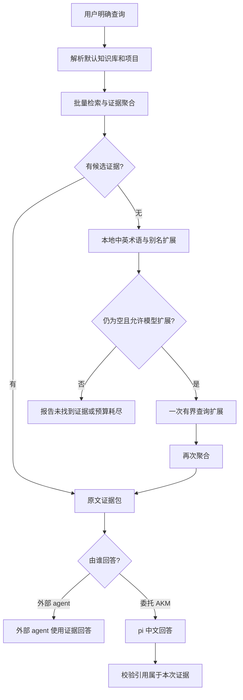
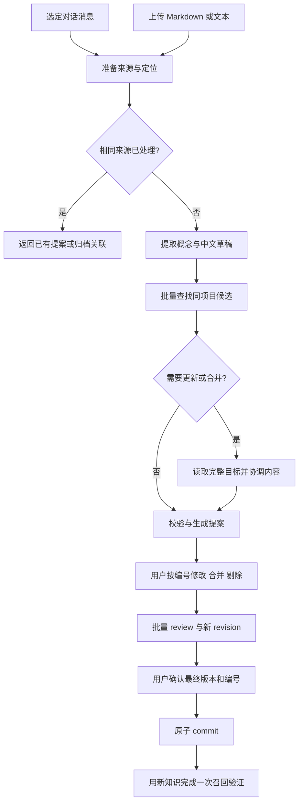

# AKM 下一轮优化设计：固定工作流工具化与真实场景回归

状态：设计提案，尚未实施。日期：2026-10-12。

依据：[独立评审报告](independent-akm-review-2026-10-12.md)。本轮只新增设计文档，不修改代码、知识库或历史评测。

## 1. 对报告的解读和本轮选择

报告反映出三个不同问题：

1. **内容可信度**：模型把“小于”改成“非递增”，也遗漏文末的反驳和限定。核心概念正确仍可能误导实际实现。需要保护原始条件与出处，不能仅调整提示或翻译。
2. **流程效率**：固定的检索、分页、JSON 编辑被交给模型逐步调度，增加请求轮次和历史上下文传输。需要合并确定性步骤，而不是不断增加细粒度工具。
3. **评估可信度**：最后一轮 usage 不代表总消耗；模拟 provider 不代表真实模型质量；合成排序 benchmark 不代表用户工作流。需要独立测量三者。

可选路线：

| 路线 | 适合解决 | 局限 |
|---|---|---|
| 只修 prompt 与 metadata | 快速减少格式问题 | 无法建立内容保真、完整审核与性能证据 |
| **业务流程工具化＋场景回归（推荐）** | 模型往返、合并保真、证据打包、测量缺口 | 需要明确工具契约；收益必须实测 |
| 优先向量检索＋长期 agent session | 语义召回、大任务连续性 | 不直接解决归档失真、重复调度和测量缺口；增加依赖与陈旧上下文风险 |

本轮选第二条。沿用 pi、Obsidian Markdown、默认中文、显式检索、人工确认提案、默认知识库发现和项目模块边界。用户仍只需关心内容、tag、alias、related、project，以及 `[1]` 编号操作。

暂不加入 PDF/OCR、持久 agent memory、异步 job 服务或新向量基础设施。独立进程仍可由外部 agent 与其他检索并发运行；不宣称已有后台任务 API。

## 2. 工具的两层边界

对外暴露四个业务操作。下表是目标契约，不是当前已实现命令。

| 操作 | 输入 | 输出 | 是否调用模型 |
|---|---|---|---|
| `propose` | 对话选段或文档、项目选择 | 带稳定编号的新增/更新提案、必要差异 | 内容提取需要；原文重复命中可复用现有结果 |
| `review` | 提案版本、批量修改/合并/剔除 | 新版本提案、改动差异 | 标签修改、剔除、来源并集无需；语义改写/合并正文需要 |
| `retrieve` | 问题、可选查询变体、项目、预算 | 原文证据包、引用、缺失与截断说明 | 默认无需；调用者显式选择扩展/代答时允许有限调用 |
| `commit` | 已确认的版本和编号 | 原子提交回执 | 不需要 |

CLI 与 pi custom tools 调用同一套业务实现，避免维护两套逻辑。Skill 只教外部 agent 何时调用、如何展示和确认，不负责重新拼装工作流。

内部第一优先工具为 `akm_retrieve_evidence`：一次完成批量检索、排名融合、重复片段消除、章节读取、引用打包。它自身不偷偷调用模型。需要查询扩展时，由外层工作流安排并记录一次模型调用；这样不会在工具中隐藏额外成本或形成递归 agent 调用。

底层 read/search 保留为补充和诊断能力，正常问答优先使用证据包。

## 3. 召回工作流



### 3.1 检索和选段

- 所有查询统一绑定选定项目；默认不跨项目建立知识依赖。允许跨项目时必须显式选择并显示归属。
- 一个请求最多接收 3 个查询变体，保留原问题；采用固定版本的排名融合，不把不同查询的原始 BM25 分数直接相加。
- 重复片段按位置/hash 消除。同源页面采用软限制，避免垄断 top-k；但保留互补的事实、例子和限定，不能把同源等同于重复。
- 小页在预算内直接读取全文；长页读取命中章节及其定义、条件、更新/争议段落，而不是一律截取开头。
- 选段规则是确定性的相关性启发式，不声称已经判断答案充分性。模型仍需识别“相关但不包含所问事实”。
- 首轮输出包含已返回段落、未返回范围、预算和截断状态。补充读取按章节/证据 ID，一次可取多个位置，避免逐个字符 offset 调度。

### 3.2 证据包契约

```json
{
  "snapshot_id": "opaque-id",
  "evidence": [{
    "id": "e1",
    "title": "安全分布式锁",
    "project": "分布式系统",
    "page_id": "stable-page-id",
    "page_hash": "hash",
    "citation": "内部可解析链接，显示短标题",
    "passages": [{"start_line": 20, "end_line": 34, "text": "原文段落"}],
    "source_refs": ["来源及原文位置"],
    "omitted_ranges": []
  }],
  "retrieval_state": "candidates_found",
  "budget_exhausted": false
}
```

内部状态只区分找到候选、没有候选、预算不足，不自动把“找到候选”标成“证据充分”。hash、snapshot、预算等为机器字段，正常 UI 只显示短标题、项目和必要的证据片段。

同一任务不能混用页面不同版本：证据包固定已读内容；补读与已有 hash 不一致则返回冲突，不悄悄刷新。模型输出中的引用必须属于本次证据集合；通过引用校验也不等于事实被证据支持，后者另作质量评估。

### 3.3 零命中与模型预算

普通 `retrieve` 维持可离线的确定性路径。本地词表来源于项目内的中英 alias/术语，不把词法映射当作通用翻译。

外部 Codex 可以在一次工具调用中传中文问题及英文术语变体，直接拿证据自行回答，避免再让内部模型总结。若需要自动恢复，调用者显式启用扩展；内部代答也允许最多一次扩展。扩展只能改变查询，不能改变项目或语料范围。

默认正常代答目标为一次回答模型调用；恢复查询最多增加一次；回答阶段最多允许一轮批量补证。达到请求/token/时间预算即返回已有证据和限制，不无限自我重试。

完全无关问题要求不编造；话题相关但事实缺失允许返回相关证据并说明缺失，例如 PostgreSQL 18.1 的特定集群配置不能由旧文推断。

## 4. 对话总结与资料上传：共享提案流水线



### 4.1 来源准备与重复处理

共用来源内容 hash、稳定段落/message ID、处理版本和归档关联。重复检测依据内容，不仅是文件名；失败的旧提取不能视为已完成。

完全相同且已确认的来源返回现有页面；仍待审核的来源返回原提案。用户主动要求重提取时产生新运行，记录提取策略版本。来源 hash 复用是确定性幂等，概念相似只是候选，不自动覆盖页面。

长文按章节/token预算分块，全部内容纳入处理覆盖，保留开头定义、文末修订和段落定位；不能用前 8000 字符代表整篇资料。超出任务预算时在调用前提示拆分/缩小任务，或明确暂停剩余部分，不能静默遗漏尾部。第一版仍限制 `.md/.txt`。

对话只发送用户选择的消息区间，保留角色、否定、撤回与最终确认。`source_message_ids` 用于归档出处，不代表此前未将其他输入消息发送给模型。

### 4.2 条件、限定和来源保护

内部维护“草稿主张 → 来源段落/message ID”的支持关系；这些不作为正常审核 metadata 展示。

- 日期/版本、作者观点、反驳/修订、比较条件和适用范围必须保留在知识正文中。
- 符号、数值、量词等检查只能发现可疑变化，不能确定性证明自然语言改写正确。保真测试与人工评审不可替代。
- 发现高风险条件变化或冲突时，可增加一次定向核查调用；该调用进入成本账本。仍无法解释则标记待处理，提交前要求明确修正。
- 既有页面更新必须提供完整目标正文及来源；预算不够就推迟更新，不用局部段落替换全页。

以 fencing 为例：正文应准确写“存储端拒绝比已见最大 token 更小的请求”。不能由该原文推出“相同 token 一律拒绝”；对相同 token 的业务幂等规则另行说明证据不足。

### 4.3 合并与关系

本轮实现**提案项之间的合并，以及提案合入一张既有页面**；两张已归档页面的删除/重定向合并留待后续，避免同时扩展链接迁移范围。

`review` 一次接受多个编辑操作。合并时先构造内容草稿，再确定性合并原始来源、别名和关系；保留条件和矛盾，不把冲突自动抹平。被合并项的编号保留为内部记录，幸存编号不重新排序，便于后续对话引用。

来源并集必须由程序完成，不能依赖模型记得复制所有来源。最终正文经用户确认后才提交，revision 不能替代用户同意。

关系可以指向同批提案编号，例如 `item:2`。提交时解析为被选中的真实页面；目标被剔除或未选择时提示处理依赖，不创建悬空链接。所有关系默认项目内解析，跨项目依赖不能悄悄进入提案。

### 4.4 用户看到的输入输出

```text
用户：把这次讨论和 inbox 的锁文章整理进“分布式系统”。

[1] 安全分布式锁的栅栏令牌
存储端记住已见最大 token，拒绝更小 token 的请求。
暂停导致租约过期后，客户端检查不能独自阻止过期写入。
项目：分布式系统
标签：#分布式锁 #fencing
别名：fencing token
相关：[2] 进程暂停与过期写入 [新创建]

[2] 进程暂停与过期写入
GC 或网络延迟可能让旧持有者在租约失效后继续写入。
项目：分布式系统
标签：#分布式锁
相关：[1] 安全分布式锁的栅栏令牌 [新创建]

[3] Redlock 的适用范围与争议
区分效率和正确性需求；保留作者观点、日期和原文反驳提醒。
项目：分布式系统
标签：#分布式锁 #Redis

用户：把 [2] 合入 [1]，剔除 [3]。
AKM：已生成合并后的 [1]，保留两项来源并移除自引用。
      展示最终正文和必要差异，等待确认。

用户：确认归档 [1]。
AKM：已归档。

用户：为什么旧锁持有者恢复后仍可能破坏数据？
AKM：从 [1] 取回证据，解释租约过期和存储端 fencing 检查。
```

新项目仍标 `[新创建]`。revision、来源 hash、成本统计不进入以上常规视图；必要的条件歧义和待决冲突才展示给人。

## 5. pi 的职责与性能测量

pi 保留模型适配、短任务 session、工具循环、取消和生命周期事件。AKM 承担确定性流水线、证据与事务。无需为本轮引入持久 session 或 compaction；Vault 才是长期知识。

测量单位是一次用户任务，不是最后一条 assistant 消息。保存：

- 每次真实请求和每轮 assistant 的 usage，去重后求和；无 usage 则标 unavailable，不能记 0。
- 输入、输出、缓存命中和 reasoning 字段按 provider 定义分别记录；避免将已包含的子项再次加到 totalTokens。
- 模型请求数、工具调用数、各阶段耗时、端到端 p50/p95、超时/失败/重试、预算耗尽。
- 语料、配置、prompt、工具版本和 hash；扩展查询、选段理由、截断、最终引用及提交回执。

服务处理耗时不包含用户停下来审核的时间；完整交互的人工等待另记。外部模型 usage 无法取得时，只能报告 AKM 内部成本，不能宣称两个 agent 总成本下降。

上下文 token 预算应按模型 tokenizer 或明确标注的估算执行。初始实验预算建议 6000 个估算输入证据 token，允许一次补证，总证据上限 12000；最终以实测校准，不把字符数当精确 token。

## 6. 回归与验收

保留原 40 题合成排序测试和历史真实数据。新增三层验证：

| 层级 | 验证内容 | 用途 |
|---|---|---|
| 确定性/模拟 SDK | 批量编辑、来源并集、幂等、版本冲突、关系解析、工具契约和累计 usage | 快速协议与工程回归 |
| 冻结语料召回/代答 | 英文原库与中文副本分别测试；真实模型、自然问题、零命中恢复、文末限定 | 测知识利用和真实回答质量 |
| 完整场景 | 长对话、重复文档、冲突更新、合并剔除、外部 agent 跨 cwd 调用后召回 | 测用户工作流是否完成 |

最小场景包：

1. 长对话包含建议、拒绝、撤回、最终决定；修改 tag、合并两项、剔除一项，提交后查询最终决定。
2. 英文文档生成中文知识；尾部有反驳/勘误；验证条件、限定、引用和跨语言查询。
3. 同内容再次上传不新增页面、不重复调用提取模型；新版本上传形成更新提案并保留历史来源。
4. 两项目存在同名概念，验证候选、关系和提交范围，不把外部项目连入默认模块。
5. 初次中文零命中、完全无关问题、相关话题但事实缺失；分别验证恢复、结束和安全拒答。
6. 在 dirA 的外部 agent 使用默认发现调用 dirB 的 AKM，完成提案/审核/提交/取证。异步 job API 不列为本轮已交付功能。

评分采用答案所需事实与条件、限定、引用支持度，而非预期页面名。页级 MRR/nDCG 继续保留，但不能替代“证据包覆盖所需主张”。负查询拆成完全无关与具体事实缺失两类。

性能实验在同一冻结语料上比较 A 大全文、B 小上下文＋自由分页、C 聚合证据工具，使用自然问题、不强制工具序列。每题至少 5 次，交错运行并保留缓存/网络情况；样本不足时不强调 p95。

**验收门槛：**

- 所有关键条件与撤回/最终决定案例通过，无伪造引用；质量失败优先于性能收益。
- 来源不丢失、重复提交和上传幂等、项目关系契约一致、旧 revision/hash 冲突不覆盖。
- 正式知识仅在用户确认后写入，完整三条工作流可复核。
- 目标为总输入 token 中位数降低 20%、端到端中位时延降低 15%，p95 不明显恶化；这是目标，不是收益承诺。
- 逐题与分组展示退步，不能用总平均分掩盖中文、限定或负查询失败。

## 7. 实施顺序与交付边界

| 阶段 | 交付 | 进入下一阶段的条件 |
|---|---|---|
| 1. 测量与评分 | 全轮 usage/耗时账本、旧评分复核版、保真/负查询 rubric | 单轮、多轮、失败运行统计可核对；不覆盖旧评测 |
| 2. 召回工具化 | 证据聚合、同源软去重、章节读取、零命中有界恢复 | A/B/C 质量比较完成，性能收益有可复核记录 |
| 3. 归档与审核闭环 | 来源准备/幂等、候选批查、条件保护、保留来源的提案合并、同批关系 | 对话/文档/召回完整场景通过 |
| 4. 外部适配与总结 | CLI/skill 契约更新，跨 cwd 场景，真实优化报告 | 确认路径发现、调用次数、最终引用和写入范围一致 |

新增索引与术语表是项目/Vault 内可重建派生数据；Markdown 和原始来源仍是事实依据。原真实评测库不就地重写，修正版另存并比较。现有命令保持兼容，高层业务操作先作为新接口加入。

提取阶段的两步“草稿→候选协调”可能增加一次模型调用，应只在确有候选或冲突时执行。首轮范围优先短中篇资料；大型多文档并行调度、向量检索、长期 session、PDF/OCR、两张正式页面的迁移合并另开设计，不混入本轮性能结论。

本提案的默认决策为：项目内依赖、中文内容、宿主 agent 按任务需要自主触发查询、内部状态不占用户注意力、聚合工具优先、质量先于节省。尚待真实 A/B 结果决定预算与排序参数，不预先宣布某组参数最优。
